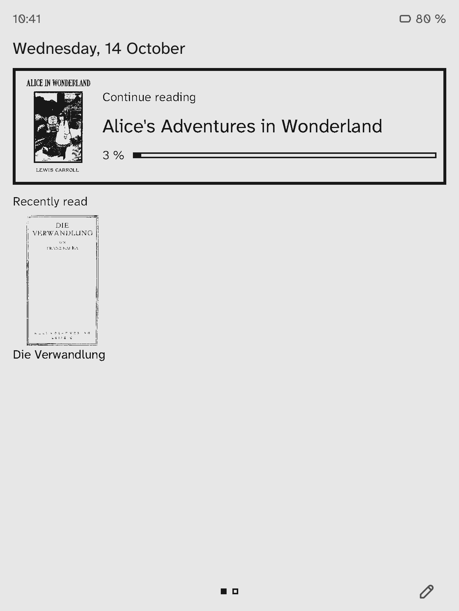
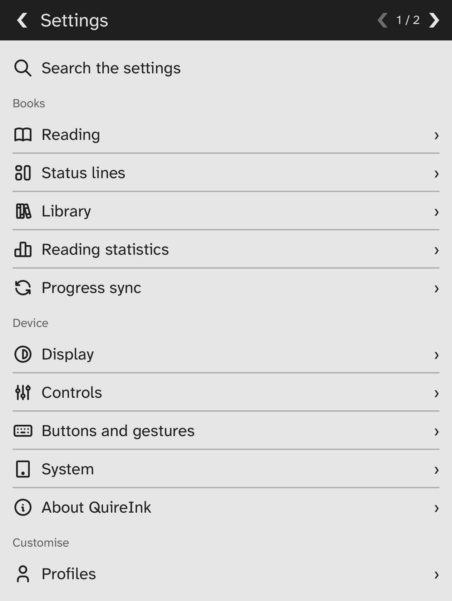

# PaperPaw

**A lean, fast and endlessly customisable e-reader for e-ink devices, from a
microcontroller with 400 KB of RAM to Linux and Android e-readers, from one
codebase.**

PaperPaw was called QuireInk up to version 0.3.

> **Status: early releases (0.3).** PaperPaw runs on Android e-readers
> (tested on a Boox Go 7) and in the desktop emulator: EPUB, FB2,
> Markdown, text, comics and PDF, colour pictures on colour screens,
> reading positions, bookmarks and highlights shared with KOReader,
> Calibre's wireless connection, OPDS catalogs and much more; see the
> [changelog](CHANGELOG.md). The firmware for the Xteink X4 and X4 Pro
> runs on both readers and comes with its first release; the X4
> Classic's is built but not yet tried on one.

<p align="center">
  
  
  
  
</p>
<p align="center"><sub>As on a Boox Go 7 (in the emulator): home screen, reading, the reading menu, the settings.</sub></p>

## Get it

The Android app (arm64, Android 8 or later) is attached to each
[release](https://github.com/hthoene/paperpaw/releases); F-Droid is to
follow. To build it yourself, see [shells/android](shells/android/README.md).

To read your books, PaperPaw needs *All files access*; the home screen
asks for it. Android 13 and later may grey out that switch for apps
installed from a browser or a file manager (a "restricted setting"). Open
*Settings, Apps, PaperPaw*, choose *Allow restricted settings* in the
menu at the top, then turn the switch on. Where that menu has no such
entry, a computer with `adb` lifts the restriction:

```sh
adb shell appops set --user 0 org.paperpaw.app ACCESS_RESTRICTED_SETTINGS allow
```

For updates as they are released, [Obtainium](https://github.com/ImranR98/Obtainium)
installs new versions from the releases page.

## Why PaperPaw?

- **400 KB of RAM is enough.** The smallest target is the Xteink X4, an
  ESP32-C3 with 400 KB of RAM and no PSRAM. PaperPaw runs there in a heap
  of 256 KB, and its firmware takes 6.5 MB of the 16 MB of flash.
- **Everything is a plugin.** The core is a small kernel. The home screen,
  library, reader, menus, file formats, themes, key maps and translations are
  plugins. First-party ones use exactly the same SDK as community plugins.
  Anything can be added, replaced, reconfigured or removed.
- **Simple by default.** Turn it on and keep reading. Every function is at
  most two steps away, and it works with buttons only or with touch.
- **One codebase, many devices.** Xteink X4/X3/X4 Pro, Kobo, Kindle (jailbroken),
  PocketBook, reMarkable, Boox and other Android e-readers, desktop and web.
  Grayscale and colour e-ink.

## How it's made

PaperPaw is a one-person project. Much of its code and documentation is
written with the help of an AI model (Claude, by Anthropic); its maker
decides what goes in, every change has to pass about 4,000 tests,
snapshot tests of its screens and the other checks before it is merged,
and releases are built reproducibly and tried on a real reader first.
PaperPaw is young and may have rough edges; issues and wishes are welcome.
More at [paperpaw.org/about](https://paperpaw.org/about).

## Customisation at a glance

A plain text file (`paperpaw.ini`) on the device changes behaviour without
any programming:

```ini
[core]
language = de
full-refresh-interval = 8

[slots]
# Replace the home screen with any screen a plugin provides.
core.home = diagnostics.screen

[keymap.global]
# Bind any input to any action; `none` removes a binding.
long.page-forward = core.toggle-night-mode
tap.center = none
swipe.up = core.menu

[menus]
# Redefine any menu: which actions, in which order.
core.reader-menu = reader.font-larger, reader.font-smaller, core.toggle-night-mode, core.home

[plugins]
# Switch any plugin off by its id (or use Settings → Plugins).
some-plugin = off
```

Plugins contribute screens, actions, settings, key maps and translations
through the [`paperpaw-sdk`](crates/paperpaw-sdk) crate. See
[docs/plugins.md](docs/plugins.md) for the full extension model.

### Plugins without code

A folder with a few text files is a plugin too. Copy it into the `plugins`
folder of the device (on Android: `PaperPaw/plugins` on the device's
storage) and restart; it shows up in *Settings → Plugins*, where it can be
switched off again. These work on every device, including the Xteink X4.

```text
plugins/large-print/
  plugin.ini     [plugin] id, name, description, version
  i18n/*.ini     translations, also whole new languages
  keymap.ini     key bindings, as in paperpaw.ini
  settings.ini   new defaults for any setting, e.g. [core] font-size = 14
  fonts/*.ttf    fonts to read with (also .otf, .ttc)
```

[`samples/plugins/large-print`](samples/plugins/large-print) is a complete
example. Plugins with code are Rust crates using the SDK; they are built
into the app (a web firmware builder for the X4 is planned) or, on larger
devices, will be loadable as WebAssembly. [Writing plugins](docs/plugins.md)
walks through [`samples/hello-plugin`](samples/hello-plugin/src/lib.rs), a
small one to start from.

## Try it in the emulator

You need a recent stable [Rust toolchain](https://rustup.rs). The required
targets are installed automatically from `rust-toolchain.toml`.

```bash
cargo run -p paperpaw-emulator -- --profile xteink-x4
```

```bash
cargo run -p paperpaw-emulator -- --list-profiles
```

Keys: `PageDown`/`Space` next page, `PageUp` previous page, arrow keys,
`Enter` confirm, `Esc` back, `M` menu; hold a key for a long press (holding
`Enter` opens the menu on devices without a menu button). The mouse acts as
the touch screen: tap the left or right edge to turn pages, the centre for
the menu. `F2` shows refreshed regions, `F12` saves a screenshot.

Devices with only two buttons (and Bluetooth page turners) can operate
everything with the *Two buttons* layout (`core.keymap-preset`): a short
press moves forward or back, a long press on forward confirms or opens the
menu, a long press on back goes back. Try it with
`--profile two-buttons`.

Settings changed in the UI are saved to `paperpaw.ini` in the library
folder, the same file you can edit by hand.

The emulator uses `samples/library` as the device storage; two
public-domain books are included as EPUB and TXT. Put your own `.epub` and
`.txt` files into
`samples/library/books` or point `--library` at any folder.

The emulator enforces each device's heap budget on the kernel, so memory
problems show up on the desktop before they show up on hardware
(`--heap-budget none` shows the real peak, `--trace-alloc 1024` lists the
large allocations behind it, `--heap-report` groups the live heap by call
site), and `--trace` prints what drawing each frame asks of the storage,
band by band, as the X4 draws it. Headless
runs produce screenshots for tests and bug reports:

```bash
cargo run -p paperpaw-emulator -- --headless --profile boox-go-7 --set core.language=de --script "page-forward,long:page-forward" --screenshot out/go7.png
```

## Repository layout

| Path | Contents |
|------|----------|
| `crates/paperpaw-platform` | Vocabulary shared by shells and kernel: display info, pixel formats, raw input |
| `crates/paperpaw-config` | The human-editable config format used for settings, key maps and translations |
| `crates/paperpaw-i18n` | Message catalogs, fallback chains and plural rules |
| `crates/paperpaw-graphics` | Framebuffers in native pixel formats, clipped canvas |
| `crates/paperpaw-text` | Fonts (runtime outlines or bitmap packs), rasterizer, glyph cache, line breaking |
| `crates/paperpaw-document` | Format-independent document model: locators, blocks, offset maps |
| `crates/paperpaw-layout` | Deterministic page layout usable by any reader plugin |
| `crates/paperpaw-zip` | Streaming ZIP reader with small, bounded memory use |
| `crates/paperpaw-xml` | Incremental XML/XHTML tokenizer |
| `crates/paperpaw-stardict` | StarDict dictionaries looked up in place (dictzip, synonyms) |
| `crates/paperpaw-sdk` | **The plugin SDK**: the only API plugins use |
| `crates/paperpaw-core` | The kernel: plugin host, registries, input routing, refresh policy |
| `crates/paperpaw-app` | The standard app: the first-party plugin set shells install |
| `crates/paperpaw-fs` | Storage in a host directory, for shells with an operating system |
| `plugins/` | First-party plugins: home screen, reader, library, file manager, menu, settings, plugin manager, menu editor, keyboard, profiles, dictionary, vocabulary, translation, Readwise, Wikipedia, news feeds, Wallabag, sleep screen, reading statistics, progress sync, catalogs (OPDS), browser, Wi-Fi (where PaperPaw manages it), Wi-Fi transfer, formats (EPUB, FB2, CBZ, Markdown, TXT, XTC), hyphenation, reading aids, default fonts, diagnostics, about (version and licences) |
| `tools/fontgen` | Converts fonts into bitmap font packs for small devices |
| `shells/desktop` | Desktop emulator with device profiles |
| `shells/web` | The emulator in a browser (WebAssembly), with data plugins and their checks ([web emulator](docs/web-emulator.md)) |
| `shells/android` | Android app for e-readers such as Boox ([build and install](shells/android/README.md)) |
| `shells/xteink` | Firmware for the Xteink X4 ([build, save the stock firmware, flash](shells/xteink/README.md)) |
| `samples/` | Emulator library with public-domain books, sample plugins |
| `docs/` | [Writing plugins](docs/plugins.md) and [architecture decisions](docs/adr/) |

## Contributing

Contributions are very welcome: code, translations, device profiles and
testing on real hardware. Please read [CONTRIBUTING.md](CONTRIBUTING.md).

## License

PaperPaw is licensed under the [Apache License, Version 2.0](LICENSE).
The bundled fonts, [Literata](https://github.com/googlefonts/literata) and
[Source Sans 3](https://github.com/adobe-fonts/source-sans),
are licensed under the [SIL Open Font License 1.1](plugins/fonts-default/fonts/).
